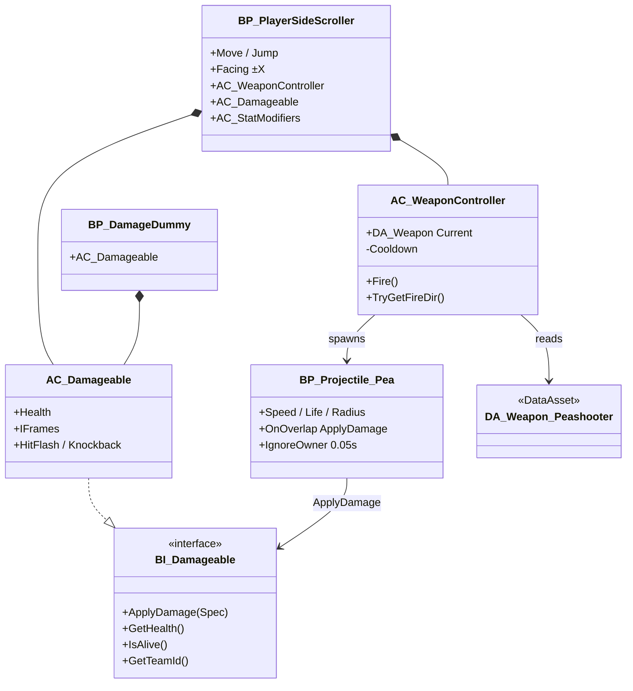
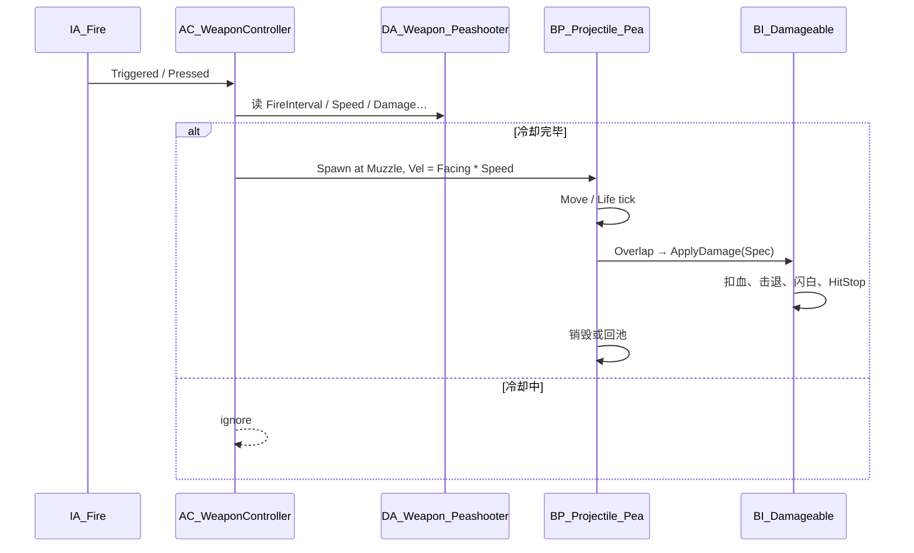

# Combat P0 实现清单 — 移动 · 豌豆枪 · Damageable

**状态:** P0 核心已进 C++（2026-11-04）。`Lab_CombatP0.umap`、Flipbook、`BP_*` / `DA_*.uasset` 不进仓库，按 `Docs/Combat_P0_LabSetup.md` 在本地补。Jump = **5** 帧。  
**依据:** `UE_PROJECT_SPEC.md` · `CombatFeel.md`（冲突以 CombatFeel 为准）  
**负责人:** 弹芯  
**范围外:** 散弹/矛枪、敌人 AI、词条管线、Boss、联网

---

## 1. 验收标准（仓库就绪后一次 PR 可玩）

- [x] `Run_Test`（或临时 `_Dev` 关）可控制角色左右走、跳、急停  
- [x] 按住/点按开火发射豌豆弹；弹道可见；撞墙销毁  
- [x] 命中实现 `BI_Damageable` 的目标：扣血、闪白、轻击退  
- [x] 玩家受击：I-Frame 闪烁 + 击退（可用调试键或测试炮塔触发）  
- [x] 命名与路径符合工程规范；数值来自 DA，无散落魔法数  

---

## 2. 占位类 / 资源命名（按规范）

### 2.1 蓝图与组件

| 名称 | 类型 | 路径 |
|------|------|------|
| `BP_PlayerSideScroller` | Character | `Content/Blueprints/Characters/` |
| `AC_WeaponController` | Actor Component | `Content/Blueprints/Combat/` |
| `AC_Damageable` | Actor Component（实现接口） | `Content/Blueprints/Combat/` |
| `AC_StatModifiers` | Actor Component（词条官提供；弹芯只读） | 随玩家；API 见 AffixSubsystem_API |
| `BP_Projectile_Pea` | Actor | `Content/Blueprints/Combat/` |
| `BP_CombatSandboxPawn` | 可选：无美术时的胶囊占位玩家 | `Content/_Dev/Combat/` |
| `BP_DamageDummy` | 受击木桩（验收用） | `Content/_Dev/Combat/` |

### 2.2 接口 / 结构 / 枚举

| 名称 | 类型 | 路径建议 |
|------|------|----------|
| `BI_Damageable` | Blueprint Interface | `Content/Blueprints/Combat/` |
| `S_DamageSpec` / `FDamageSpec` | Struct | BP: `Content/Blueprints/Combat/`；若 C++ 则 `Source/PixelSideRL/Combat/` |
| `E_TeamId` | Enum | `Player` / `Enemy` / `Neutral`（P0 防自伤） |

**`BI_Damageable` 函数**

| 函数 | 入参 | 说明 |
|------|------|------|
| `ApplyDamage` | `S_DamageSpec Spec` | 扣血、击退、HitStop、闪白；返回是否仍存活 |
| `GetHealth` | — | 当前 / 最大（调试与 HUD 预留） |
| `IsAlive` | — | |
| `GetTeamId` | — | 过滤友伤 |

**`S_DamageSpec` 字段（P0 最小集）**

`Damage` (float) · `Knockback` (float，沿命中水平方向) · `HitStopVictim` (float) · `HitStopInstigator` (float) · `SourceActor` (Actor) · `InstigatorController` (Controller，可空) · `DamageTypeTag` (Name/GameplayTag，P0 固定 `Default`)

### 2.3 数据资产

| 名称 | 路径 |
|------|------|
| `DA_Weapon_Peashooter` | `Content/Data/Weapons/` |

字段对齐 `CombatFeel.md` §4.1：`FireInterval`, `Spread`, `ProjectileSpeed`, `ProjectileRadius`, `Damage`, `KnockbackToEnemy`, `HitStop_Player`, `HitStop_Enemy`, `CamShakeScale`, `ProjectileLife`, `ProjectileClass`。

可选（P0 可硬编码进角色再迁表）：`DA_PlayerMoveFeel`（MaxWalkSpeed、加减速度、Jump、Coyote、Buffer、Gravity…）。

### 2.4 输入

| 资源 | 路径 |
|------|------|
| `IMC_Combat` | `Content/Input/` |
| `IA_Move` | Axis1D（A/D 或 左摇杆 X） |
| `IA_Jump` | Digital |
| `IA_Fire` | Digital（按下开火；豌豆为全自动则 Triggered 连发） |

映射进 `BP_PlayerSideScroller`（或 PlayerController 再下发）。**P0 不做** `IA_Aim` 自由瞄准；开火方向 = 角色朝向 ±X。

### 2.5 C++ 占位（仅必要时；可延后到 BP 验证后）

| 类 | 模块 | 职责 |
|----|------|------|
| `UPixelSideRLDamageTypes` 或头文件里的 `FDamageSpec` | `PixelSideRL` | 若要在多模块复用 Struct |
| `APixelProjectile` | 可选基类 | 对象池钩子；P0 可用纯 BP + 简单数组池 |

P0 **不强制**开 C++；若仅 BP 能验收，C++ 文件夹只留模块空壳。

### 2.6 地图 / 相机

| 名称 | 路径 | 说明 |
|------|------|------|
| `Lab_CombatP0` | `Content/_Dev/Combat/` | 长平台 + 木桩；正式关用不进此目录 |
| 相机 | 挂玩家的 `Camera` 正交，Arm 长按 ArtBible；P0 固定高度、仅跟 X |

---

### 2.7 词条挂钩（对齐 `AffixSubsystem_API.md` v1；P0 不接满）

契约见 `Docs/AffixSubsystem_API.md`。弹芯 **禁止** 自建 Roll；优先读玩家身上 `AC_StatModifiers`（与 Subsystem 一致）。

| 挂钩 | 挂载点 | P0 / 之后行为 |
|------|--------|----------------|
| `GetStat(EStatId)` | `AC_WeaponController`、移动、`AC_Damageable` | 开火/移速/伤害/击退只经此读取；P0 无 Affix 时 = Base（含武器 DA） |
| `OnAffixChanged` | 玩家绑定 | 刷新缓存的 FireRate / Damage / MoveSpeed 等 |
| `OnStatsRebuilt` | 可选 | 脏标记，避免每枪扫全表 |
| `OnAffixTrigger` | 可选，P1+ | OnKill / OnTakeDamage 表现钩子；Modifier 仍归词条官 |

**Stat 映射（战斗侧）**

| 用途 | `EStatId` | 战斗用法 |
|------|-----------|----------|
| 移速 | `MoveSpeed` | 最大水平速度 |
| 射速 | `FireRate` | **乘区**（默认 Base 1.0）；DA 存 `FireInterval`（秒）；冷却 = `FireInterval / GetStat(FireRate)`；Mul=Π(1+Value) |
| 伤害 | `Damage` | `Spec.Damage = GetStat(Damage)`（已含 Base→Meta→Affix） |
| 击退 | `Knockback` | 写入 `Spec.Knockback` |
| 穿透 | `Pierce` | P1 矛枪；P0 = 0 |
| 弹数 | `ProjectileCount` | P1 散弹；P0 = 1 |
| 最大生命 | `MaxHP` | `AC_Damageable` 上限 |

`BeginRun` 后 Meta 已注入 Stat，Inventory 可为空——开战即可 `GetStat`。

## 3. 职责关系（类图）

---

## 4. 运行时序（开火 → 命中）

---

## 5. 实现任务拆条（建议工时粒度）

| ID | 任务 | 依赖 | 完成定义 |
|----|------|------|----------|
| P0-1 | 建 `_Dev/Combat` 沙盒关 + 正交相机跟 X | — | [x] 空关可进（GameMode 灰盒 + 正交相机；umap 见 LabSetup） |
| P0-2 | `BP_PlayerSideScroller` 移动参数按 CombatFeel §2 | P0-1 | [x] `APixelSideCharacter` + `UPixelSideCharacterMovement` |
| P0-3 | 输入 `IMC_Combat` + 三角色绑定 | P0-2 | [x] 运行时 `IA_Move` / `IA_Jump` / `IA_Fire` |
| P0-4 | `BI_Damageable` + `S_DamageSpec` + `AC_Damageable` | — | [x] `IDamageable` / `FDamageSpec` / `UDamageableComponent` |
| P0-5 | `BP_DamageDummy` 挂接口；闪白/击退 | P0-4 | [x] `APixelDamageDummy` |
| P0-6 | `DA_Weapon_Peashooter` 填表 | — | [x] `UDA_Weapon_Peashooter` 默认 §4.1（uasset 本地可选） |
| P0-7 | `AC_WeaponController` 冷却 + 朝向开火 | P0-2, P0-6 | [x] `UWeaponControllerComponent` |
| P0-8 | `BP_Projectile_Pea` 运动/寿命/撞墙/Overlap | P0-7 | [x] `AProjectilePea` |
| P0-9 | 弹→`ApplyDamage` 接好；轻 HitStop | P0-5, P0-8 | [x] 木桩扣血、闪白、击退、Victim HitStop |
| P0-10 | 玩家 `AC_Damageable` + I-Frame；调试伤害源 | P0-4 | [x] I-Frame 闪烁；H 与 `APixelDebugHurtTurret` |
| P0-11 | 文档回写：本清单勾选 + CombatFeel 变更一行 | 上列 | [x] 本文件 + `Combat_P0_LabSetup.md` |

**并行建议:** P0-4/5 与 P0-2/3 可并行；P0-6 可最先做。

---

## 6. 与邻模块接口（只占位，P0 不实现）

| 模块 | 约定 |
|------|------|
| 词条官 | 见 §2.7 与 AffixSubsystem_API v1；伤害/射速/移速只经 `GetStat(EStatId)`；不 Roll |
| 界面 | 预留 `GetHealth`；HUD 可后接 |
| 廊道 | 正式刷怪点不进 P0；木桩仅 `_Dev` |
| 点阵 | 可用纯色胶囊/方块；插画到位后换 Soft Sprite |

---

## 7. 风险与决策

| 项 | 决策 |
|----|------|
| 无仓库 | 文档与命名先冻结；**禁止**假设远端路径已存在 |
| 对象池 | P0 可用「超寿命 Destroy」；清房卡顿再上池（CombatFeel §5） |
| HitStop | P0 允许对 Victim 短 `CustomTimeDilation`；不全局慢动作 |
| 朝向 | 仅翻转 Sprite/枪口；弹速沿 ±X |

---

## 变更记录

| 日期 | 作者 | 说明 |
|------|------|------|
| 2026-11-04 | 弹芯 | 首版：P0 验收、命名表、类图、时序、任务拆条 |
| 2026-11-04 | 弹芯 | 增补 §2.7 词条 GetStat/OnAffixChanged 预留 |
| 2026-11-04 | 弹芯 | §2.7 对齐 AffixSubsystem_API v1：EStatId、FireRate=Hz、AC_StatModifiers |
| 2026-11-04 | 弹芯 | 主管拍板：FireRate=乘区，DA=BaseFireRateHz |
| 2026-11-04 | 弹芯 | 与 API 统一：DA=FireInterval；冷却=FireInterval/GetStat(FireRate) |
| 2026-11-04 | 弹芯 | P0 可玩切片进 C++（移动/豌豆/Damageable/I-Frame）。umap 与 5 帧 Jump Flipbook 见 `Combat_P0_LabSetup.md`。 |
| 2026-11-04 | 弹芯 | P0.5 Lab Grunt（`APixelEnemyGrunt` / G1）：警戒追击、水平慢弹 0.8 s / 6。正式刷怪房仍不进 P0。 |
